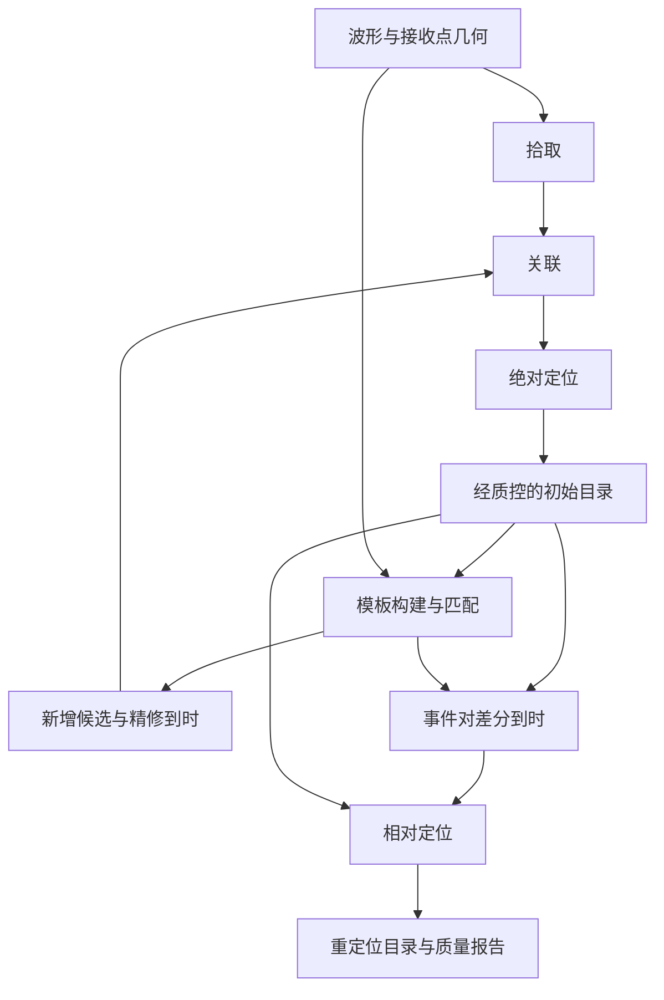

# 地震定位流程需求文档

版本：0.1 草案
日期：2026-11-06
状态：待评审；本文描述待开发能力，不代表接口已经可用。

## 1. 目标与范围

为 GeoMCP 建立可复现、可追踪的地震定位流程，完成拾取、关联、绝对定位、模板匹配、相对定位五个模块。人工 CLI、Python 脚本与 MCP Agent 共用科学逻辑、权限和任务管理。

定位流程首期以离线批处理为主；拾取模块已确定同时支持 DAS 与常规台站，贯通 DAS HDF5 和台站 miniSEED 适配器，其余模块按各自阶段交付。暂不包含模型训练、实时流服务、自动部署权重、自动发布正式目录或任意算法脚本执行。

本稿中的后端选型、资源默认值及开发优先级为建议，尚未由用户确认；科学精度和吞吐指标必须经过基准测量确定。

## 2. 项目现状与建设方案

仓库已有 Path Sandbox、Workspace、Python/CLI/MCP、JobManager、CPU/GPU Executor、Worker Registry 和 DAS Basic。现有 `SEISMOLOGY_WRAPPERS.md` 仅列出 Catalog、NLLoc、MatchLocate、HypoDD 的规划，没有完整的拾取至定位链路。

| 方案 | 优点 | 代价与建议 |
|---|---|---|
| 整体封装为单一工具 | 演示路径短 | 难以单步排错、替换后端或导入外部产物 |
| 统一数据契约、独立模块、第三方后端适配 | 可以分阶段交付、复用和比较算法 | 需先完成格式和校验；本稿建议采用 |
| 自行重写所有算法 | 内部控制力强 | 科学验证与维护成本高，首期不采用 |

复用 `API → Service → Scientific Core` 和 `Service → JobManager → Executor → Registry`。不在 MCP handler 内实现算法，不创建第二套 Job 状态机。外部程序采用固定 Wrapper，不修改第三方内部源码。后端接入前核验版本、格式、许可证及离线运行能力。

## 3. 业务流程与边界

- 主流程：波形→拾取→关联→绝对定位。
- 补充检测：质控目录→模板→连续匹配→新增候选→再次关联与绝对定位。
- 重定位：初始绝对目录＋目录/互相关差分到时→相对定位。
- 模板匹配是可选分支，不是每次定位的必经步骤；相对定位也可只使用目录差分到时。
- 匹配候选不能直接视为精确位置。新增事件需质控后才能进入下一版模板库；一次运行固定模板版本，不无限自动迭代。
- 每个模块可导入符合契约的外部产物，不强制从拾取开始。首期按阶段显式调用，不要求实现全自动工作流引擎。

## 4. 通用数据契约

### 4.1 基础约定

1. 时间使用带 `Z` 的 UTC ISO 8601，声明序列化精度；运算使用相对参考时刻的秒数，保留原始时间精度。
2. 地理坐标明确 CRS、经纬度顺序与高程基准。统一使用 `longitude_deg`、`latitude_deg`、`depth_km`（向下为正）、`elevation_m`（向上为正）；局部坐标单独声明原点、投影与单位。
3. DAS 必须提供 channel 到接收点坐标的映射、坏道和有效时间范围；道号不得作为距离或空间坐标。常规台站保留 network/station/location/channel 标识。
4. 缺失值为 `null`，不得用 0 替代缺失时间、深度或误差；拒绝非有限数值、重复主键与悬空引用。
5. 首期规范产物使用 JSON 元数据和 CSV 表格，统一 `schema_version`；波形和大型网格仅传文件引用。第三方原生输入输出同时保留。
6. 原始观测 ID 稳定，目录合并提供去重规则与 ID 映射，禁止静默改变已有事件身份。

### 4.2 核心对象

| 对象 | 最低字段和约束 |
|---|---|
| WaveformManifest | waveform_id、文件引用、格式、起止时间、采样率、分量/通道、物理量及单位、geometry_id、缺口/坏道信息；支持分块读取 |
| ReceiverGeometry | receiver_id、台站/道号、坐标、CRS、高程、有效时间段；映射唯一 |
| PickTable | pick_id、waveform_id、receiver_id、phase(P/S/unknown)、time、score、score_type、time_uncertainty_s、backend_id、model_id、quality_flags；无误差估计时为 null，score 不等于校准概率 |
| AssociationResult | event_candidate_id、pick_id、关联分数、残差、采用状态与原因；保留未关联及歧义拾取 |
| EventCatalog | event_id、origin_time、经纬度、depth_km、方法、速度模型引用、采用/拒绝观测数、时间残差 RMS、不确定性及其定义、quality_status、source_event_id |
| VelocityModel | model_id、版本/校验和、维度、Vp/Vs 或走时网格、坐标/单位、有效范围、生成配置；不同后端网格不能隐式混用 |
| TemplateBank | template_id、源事件与目录版本、参考时刻、P/S 参考到时、接收点集合、波形窗、预处理、采样率、质量及波形校验和 |
| DetectionTable | detection_id、template_id、检测时刻及其参考定义、相关/聚合分数、有效通道数、阈值定义、去重组、精修到时引用 |
| DifferentialTimeTable | event_id_1/2、receiver_id、phase、dt_s、measurement_type(catalog/xcorr)、相关系数、权重、误差、窗口/频带；定义 dt_s=t_arrival_1-t_arrival_2，适配器验证第三方符号约定 |
| RunManifest | run_id、模块、schema_version、输入/上游引用及校验和、完整参数、后端版本、模型/权重校验和、随机种子（如适用）、job_id、产物、统计和告警 |

目录必须保留成功、拒绝、未收敛记录，允许失败事件使用无坐标的状态表；不得为了得到合法坐标而丢弃失败事件。相对定位产物保留原始位置和位移，不覆盖初始目录。

STA/LTA 默认输出 unknown 相位及 stalta_ratio 分数，model_id 为 null；不得自动将 unknown 解释为 P。要求 P/S 的关联和定位后端须显式筛选并报告排除数量；分数不可跨类型或模型直接比较。拾取结果时间固定九位小数、带 Z 序列化，同时保留源采样索引/时间基准，显示精度不代表测量精度。详细契约见[拾取模块开发文档](PICKING_MODULE_DEVELOPMENT.md)。

### 4.3 运行产物

默认布局为已授权的 `outputs/location/<run_id>/{manifest.json,parameters.json,summary.json,logs/,artifacts/}`，目录导出可进入 `outputs/catalogs/`。使用 Workspace 时按 write_root 相对路径解析，不重复拼接 outputs。

运行目录相互隔离，默认拒绝覆盖。成功发布前完成产物检查；中断产物标记 incomplete，不能成为正常下游输入。下游读取结果仍需权限校验：不能假定 Workspace 的 read_root 自动包含 write_root，应使用已授权结果区或受控产物引用解析。

## 5. 模块需求

拾取模块已有统一工程实现和合成 Job 示例；PhaseNet 系真实权重推理及科学基准仍待验收，其他定位流程模块仍为需求规划。当前状态与限制见[拾取模块开发文档](PICKING_MODULE_DEVELOPMENT.md#0-当前实现与验证边界)。

### 5.1 拾取模块 `picking.*`

**输入：** 波形清单、几何、时间/通道范围、预处理、模型配置 ID、P/S 阈值、分块与重叠参数。

- PK-01：校验采样率、分量/道排列、振幅类型、单位与模型输入要求；不隐式混用应变、应变率和速度数据。
- PK-02：支持管理员登记的模型和权重，建议首先评估 PhaseNet-DAS；常规台站后端独立登记。缺失或不兼容时失败，不自动下载或替换模型。
- PK-03：按时间/通道分块推理，处理重叠边界、缺口和坏道；输出去重策略、边界标记及有效数据覆盖率。
- PK-04：输出 PickTable、P/S 和接收点统计、分数分布、拒绝原因与有界波形预览。
- PK-05：支持外部拾取导入与校验。无拾取可以是有效空结果；依赖或推理异常不能伪装为空结果。
- PK-06：首期接入 PhaseNet、STA/LTA、PhaseNet-DAS；支持台站与 DAS，采用命名预设＋单次科学参数覆盖＋管理员硬限制，冻结最终配置及来源，新增后端遵循统一适配器协议。STA/LTA 触发不等价于已识别的 P/S 拾取。

**验收：** 固定模型和样本推理可复现；边界不重复记数；覆盖缺道、空窗、错误权重与 GPU 不可用。标注集分别报告 P/S precision、recall、F1、匹配容差和到时误差。

### 5.2 关联模块 `association.*`

**输入：** 拾取、几何、后端配置、速度模型/近似速度、时间/空间搜索范围、最小观测和独立接收点数。

- AS-01：建议评估 GaMMA 适配器；输出统一关联表，粗定位标记为候选，不替代绝对定位。
- AS-02：检查同接收点/相位重复拾取，显式配置多事件歧义策略；最终采用集合互斥或保留带权多假设，不能静默重复分配。
- AS-03：支持密集事件、噪声和跨块候选合并；记录 ID 映射及拒绝理由。
- AS-04：DAS 道数与独立观测约束分别统计，支持道抽样/分组权重；相邻道多不等于空间覆盖好。
- AS-05：输出采用/未关联拾取、相位组合、几何覆盖与残差，保证所有输入拾取可追踪。

**验收：** 单事件、重叠事件、跨块及纯噪声夹具符合预期；报告事件 precision/recall、拆分/合并及未关联比例。

### 5.3 绝对定位模块 `nlloc.*`

**输入：** 候选事件与拾取映射、几何、速度模型/走时网格、搜索空间、到时权重和质量阈值。

- AL-01：建议首期使用 NonLinLoc 固定适配器；prepare 生成原生输入，validate 检查坐标、网格覆盖和观测有效性。
- AL-02：支持走时网格构建/复用；若首期只接收预生成网格，提供生成前置说明。缓存键包含几何、速度模型、网格参数和后端版本。
- AL-03：逐事件输出绝对目录、逐拾取残差、采用/拒绝列表、收敛状态、原生结果及不确定性定义；RMS 不作为位置误差。
- AL-04：识别几何退化、边界解、固定深度和观测不足；低质量解明确原因与假设。
- AL-05：概率图默认使用原生 Grid2GMT/GMT 输出，可转 PNG 展示；绘图失败单独告警，不抹去成功定位结果。

**验收：** 合成震源在预登记容差内恢复；识别网格越界和模型不兼容；解析结果与原生输出一致。不确定性缺失为 null，真实参考目录比较注明参考误差与坐标基准。

### 5.4 模板匹配模块 `matchlocate.*`

**输入：** 质控后的种子目录、参考到时、波形/几何、模板窗、频带、采样率、相关阈值与聚合/去重策略。

- TM-01：支持模板构建、检查和版本管理，明确窗口相对 P/S 或参考时刻的定义；识别低质量、缺口和通道不足。
- TM-02：评估 MatchLocate 适配器。独立互相关差分测量若不由该后端提供，另设固定注册 handler，不假定第三方包含全部能力。
- TM-03：分块匹配连续波形，保留有效通道数、每通道相关、聚合分数与阈值依据；模板和目标预处理一致。
- TM-04：跨模板、跨块去重，保留命中来源与最佳候选；种子自匹配不计作新增事件。
- TM-05：输出候选与可用精修到时。检测参考时刻与震源时刻分开，只有具备明确走时参考时才能转换。
- TM-06：支持按事件对/接收点/相位测量差分到时，限定 lag 范围，记录符号、误差、权重、相关系数、插值方法及拒绝原因。

**验收：** 注入已知延迟可恢复偏移；覆盖低相关、反极性、缺道和边界策略。使用独立噪声报告误报/小时，不能只用自匹配证明效果；已知延迟夹具验证差分符号。

### 5.5 相对定位模块 `hypodd.*`

**输入：** 初始绝对目录、几何、速度模型、目录/互相关差分到时、事件配对、求解与权重参数。

- RL-01：建议首期采用 HypoDD，生成固定格式输入，验证 ID、相位、单位和差分符号。
- RL-02：目录与互相关数据分开标记和加权；限制配对距离、共同观测数、每事件邻居数和总事件对数，防止无界两两配对。
- RL-03：报告连接图、连通分量、孤立事件和剔除事件对；显式记录固定事件/质心等参考约束。
- RL-04：输出重定位目录、初始与最终位置、位移、逐对残差、迭代统计、观测数及未重定位原因。
- RL-05：标记秩亏、不收敛、约束不足及异常位移；不能仅凭残差下降声称绝对位置改善。

**验收：** 合成事件簇验证相对位移；孤立事件保持初始位置并标记；断开分量分别评价，不声称具有共同相对精度。报告差分残差、剔除率及有真值时的相对位置误差。

## 6. 接口需求

以下接口均为拟新增能力。五个模块统一提供 `inspect/prepare/validate/run/result`：inspect 做有界输入/产物检查，prepare 生成运行清单，validate 返回问题列表，run 重新校验并提交任务，result 按 job_id 返回业务摘要。

| 命名空间 | 补充工具 | 执行方式 |
|---|---|---|
| picking | `picking.import` 外部拾取规范化 | 推理用 Job；CPU/GPU 使用分别登记的任务配置 |
| association | 无必需补充 | CPU Job |
| nlloc | `nlloc.grid_prepare` | 定位与网格生成使用 CPU Job |
| matchlocate | `matchlocate.template_build`、`matchlocate.measure_dt` | CPU Job，GPU 加速另行验证登记 |
| hypodd | `hypodd.prepare_pairs` | CPU Job |
| catalog | `inspect/stats/filter/compare/export`，逐项交付 | 有界轻量操作同步，大目录使用 Job |

大规模扫描、网格生成、模板构建必须使用 Job。复用 `job.status/result/cancel`；旧规划的 hypodd.status 如保留，只代理相同 Job 状态。

拾取补充只读发现接口 `picking.backends`、`picking.presets`；批量导入使用 Job。拾取 prepare 冻结参数和输入引用，run 使用 prepared_ref 并重新校验，具体接口以[拾取模块开发文档](PICKING_MODULE_DEVELOPMENT.md)为准，均尚未实现。

共同参数包括授权 workspace、输入引用、结构化科学参数和可选输出相对路径。后端/模型通过登记 ID 选择，不暴露 executable、command、host、port、username、config_dir、任意 task_type 或工作目录。prepare 产物及其中嵌套引用也必须校验。

三种入口共用 Service 和现有 `ApiResult(success,data,error_code,error_message,metadata)`。run 返回 job_id、status、run_id，提交成功仅表示任务已接受；result 返回 summary、manifest、质量状态和有界预览，完整结果保存在文件中。

建议 MCP 预览默认 20 行、最多 100 行，序列化摘要默认不超过 64 KiB；超限返回 truncated 与产物引用，调用方不能放宽服务硬限制。这些限制需在实现阶段落地。

错误语义至少覆盖非法输入、模式不匹配、依赖缺失、模型不兼容、网格越界、资源超限、后端失败及结果解析失败。实现时映射到现有异常/API 约定，保留权限错误，不另建不兼容的错误体系。

## 7. 任务、资源与安全

- 复用 queued/running/completed/failed/cancelled。单事件拒绝保留业务状态；有效空结果或部分事件拒绝可 completed，但 summary 必须包含成功/拒绝数量。程序异常、解析失败和必需产物缺失为 failed。
- 完成校验后才发布 manifest。取消/超时终止受管子进程并保留诊断；首期重跑新建 run，不承诺断点续算。
- 所有计算为白名单 task，executor 由注册配置确定，不静默 GPU→CPU 回退。
- 管理员配置文件字节、波形样本/通道、拾取、事件、模板、事件对、内存、输出大小、并发和 timeout 上限；提交前估计规模，执行端再次限制。
- 初期建议单科学任务 timeout 3600 秒、并发 1，具体数据规模与内存阈值在基准后登记；必要硬限制未配置时不得开放重任务。
- 建议 capability 使用模块级 `.read/.prepare/.run`，导入、网格、模板及差分测量明确映射到写/执行权限，遵循 default deny。
- 所有波形、权重、网格、模板及配置嵌套引用均经过 WorkspaceManager/PathPolicy；Worker 实际读取时复验，拒绝路径穿越、链接逃逸和原始数据覆盖。
- 外部程序采用固定 executable 和结构化参数列表，不经 shell 拼接；重依赖延迟导入、可选安装，缺包不影响基础服务启动。记录版本、许可证、离线包和权重来源，不记录凭据。

## 8. 科学评价与性能要求

验收至少准备确定性合成集、人工标注真实事件集、独立噪声集、DAS 几何退化集及跨块集；登记来源、许可、划分和校验和。模板种子与评价目标分开，披露训练/验证与评测事件重叠。

| 阶段 | 必须报告 | 判定原则 |
|---|---|---|
| 拾取 | 分相位 precision/recall/F1、到时 MAE/分位数 | 预登记一对一匹配容差和数据域 |
| 关联 | 事件 precision/recall、拆分/合并、未关联率 | 依据标注事件映射，不只统计目录数量 |
| 绝对定位 | 水平/深度/时刻误差、失败率、边界解、不确定性 | 合成真值硬验收；真实参考误差单列 |
| 模板匹配 | 检出率、误报/小时、去重、时间偏差 | 独立注入/噪声，注明阈值和有效时长 |
| 相对定位 | 相对位置误差、差分残差、位移、剔除率 | 各连通分量分别评价 |
| 性能 | 输入规模、耗时、峰值内存/显存、吞吐 | 固定机器、线程和版本，冷启动与稳态分开 |

当前没有足够基准承诺真实数据精度和吞吐。每个后端启用前必须登记数据版本、机器配置、数值容差、质量下限和资源上限；仅集成通过不能称为科学精度达标。

## 9. 验收与交付

- AC-01：五个模块独立完成 prepare/validate/run/result，支持规范外部产物。
- AC-02：波形至绝对目录闭环可运行，每条观测与上游版本可追踪。
- AC-03：模板候选回流关联/定位闭环可运行，去重和 ID 映射完整。
- AC-04：初始目录＋差分到时生成相对目录，保留初始、孤立及失败事件。
- AC-05：覆盖空输入、错误参数、缺包、超限、非零退出和结果损坏，不将异常变成空成功。
- AC-06：Python/CLI/MCP 行为一致，Schema 拒绝未知和服务器配置字段，结果体积受限。
- AC-07：成功、失败、取消和超时均正确终结 Job，不发布半成品。
- AC-08：覆盖未授权/嵌套路径、链接逃逸、只读数据、权限缺失和未注册任务；现有 healthcheck/DAS 回归通过。
- AC-09：使用独立预期值验证坐标、时间、差分符号和结果解析，不只做同一函数的往返测试。
- AC-10：交付小型离线端到端示例、参数模板、后端安装说明、数据字典和质量报告。

各模块交付 Scientific Core/适配器、Service、API、CLI、MCP Schema、Registry、权限/资源配置和测试。实现时同步 README、接口文档、路线图与 GeoMCP Skill。本次仅交付需求及导航，不将规划接口列为已实现。

## 10. 开发里程碑

| 阶段 | 内容 | 退出条件 |
|---|---|---|
| M0 | 数据契约、后端最小运行、格式转换、基准与容差登记 | 规范样本可校验，各后端有原生参考结果 |
| M1 | 拾取推理、模型登记、外部导入 | PK 与接口/权限验收通过 |
| M2 | 关联适配、跨块去重、候选映射 | AS 通过，拾取至关联贯通 |
| M3 | 网格前置、绝对定位与质量控制 | AL 通过，第一条定位主链贯通 |
| M4 | 模板库、匹配、候选回流、互相关测量 | TM 通过，补充检测贯通 |
| M5 | 事件配对、差分转换、相对定位 | RL 通过，连接与参考约束可解释 |
| M6 | 三入口、离线部署、回归与科学基准报告 | AC-01～10 通过并记录限制 |

定位可作为当前优先开发支线，不依赖先完成 RAG/Research Memory。版本编号与发布路线另行评审，本稿不自动修改现有版本承诺。

## 11. 待确认事项

| 事项 | 本稿建议默认 | 影响 |
|---|---|---|
| 首期数据域 | 拾取已确定 DAS 与常规台站同时可用；后续模块分阶段适配 | 模型和格式适配范围 |
| 后端 | 拾取已确定 PhaseNet / STA/LTA / PhaseNet-DAS；其他模块建议 GaMMA / NLLoc / MatchLocate / HypoDD | 依赖、接口与部署验证 |
| 研究区/速度模型 | M0 提供有版本模型、几何与坐标基准 | 走时和定位适用性 |
| 权重/计算环境 | 管理员登记固定权重和 CPU/GPU 配置 | 模型适用性、资源与离线包 |
| 科学验收门槛 | M0 登记真实样本、合成真值和数值容差 | 科学质量发布门槛 |
| 外部格式 | 先规范 CSV/JSON 与选定后端原生格式 | QuakeML 等扩展另排适配 |

除表中标明已确定的拾取范围与后端外，其余仍为建议。拾取已确定 unknown 相位及预设＋单次覆盖参数管理，详见开发文档。开发前优先落实样本、后端可运行性及验收门槛；其他扩展格式不阻塞 M0。

## 12. 相关文档

- [拾取模块开发文档](PICKING_MODULE_DEVELOPMENT.md)
- [新增工具开发指南](../development/TOOL_DEVELOPMENT.md)
- [地震学 Wrapper 规划](SEISMOLOGY_WRAPPERS.md)
- [Workspace](../architecture/WORKSPACES.md)
- [Job Manager](../architecture/JOB_MANAGER.md)
- [开发路线图](../development/ROADMAP.md)
