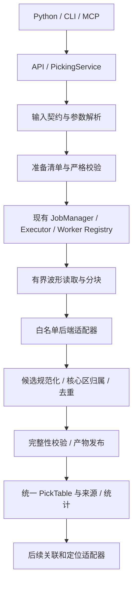

# 拾取模块开发文档

版本：0.2 实现对照稿
日期：2026-11-06
状态：设计与实现对照；统一模块及接口已有实现，真实模型与科学基准验收尚未完成。

## 0. 当前实现与验证边界

已实现统一参数解析、带签名的 prepare 快照、输入/配置复验、miniSEED/HDF5 读取、STA/LTA 跨块递归、PhaseNet/PhaseNet-DAS 固定程序适配、时间/空间分块、有限数据段切分、CSV/JSON 产物、外部 CSV 导入、Python/CLI/MCP 和 Job 生命周期。源码固定版本、许可证与来源清单位于 `third_party/`，未包含权重。正文保留完整设计目标，接口中的“拟新增”描述按本节核对实现状态。

可运行示例：`.venv/Scripts/python.exe scripts/picking_demo.py --output-dir outputs/picking-demo --run`。输出目录必须未占用；脚本创建隔离的配置与合成台站/DAS 数据，通过真实 Job 执行，不改变全局授权。测试覆盖合成链路，不代表真实数据质量达标。

当前限制：

- 深度学习适配代码已接入固定源码，但未登记真实权重或验证独立推理环境；环境文件是 candidate，不是已验证锁文件。真实权重推理、CPU/GPU 原生参考对照及科学评价仍需完成，不能宣称三类后端均已完成生产验收。
- 首版拒绝实际采样率转换，须提供另行预处理、有版本的输入；不隐式改变输入物理量。超出单块预算的 STA/LTA 可流式运行，带滤波/去趋势的连续段须在单块预算内，否则明确拒绝并要求预处理。
- 不跨多个 WaveformManifest 记录自动拼接连续状态；应将每个连续逻辑记录登记完整。几何首版接受 EPSG:4326/OGC:CRS84，经纬度字段与垂直基准须显式声明。
- 首期导入为规范列 CSV 或显式列/相位映射，不支持任意第三方原生格式自动识别。管理员配置中执行配置默认关闭，须登记资源预算后显式启用。
- 输入执行前复制到运行目录并对副本校验 SHA-256，副本也计入输出预算。运行目录与服务器配置应由管理员控制；签名不替代操作系统对私钥及目录的保护。

### 0.1 工程验证记录（2026-11-06）

本地使用项目 `.venv` 执行：

```powershell
.\.venv\Scripts\python.exe -m pytest -q
.\.venv\Scripts\python.exe -m compileall -q src scripts/picking_demo.py scripts/fetch_picking_sources.py
git diff --check
```

当前完整回归为 74 项通过、1 项因 Windows 符号链接权限跳过；编译和差异格式检查通过。合成示例通过真实后台 Job 产生台站 1 条、DAS 2 条拾取，再将台站结果作为外部 CSV 导入生成 1 条规范记录；均为 unknown。深度模型输出测试包含模拟程序夹具，不能替代真实权重推理验收。

CI 安装 `.[test,mcp,das,picking]` 执行相同测试集。第三方源码通过 `.gitattributes` 保留原始字节与上游空白，不进行换行转换；校验和同时核对工作文件和 Git 暂存内容。项目自有文件仍执行差异格式检查。源码与来源清单随 Git 提交；合成运行目录、私钥、缓存、真实波形和权重不进入提交。

## 1. 目标、范围与设计决策

本文细化[定位流程需求](LOCATION_WORKFLOW_REQUIREMENTS.md)的 PK-01～PK-05，为开发者提供可实现、可测试的拾取模块契约。首期同时贯通常规台站和 DAS 离线批处理，提供 PhaseNet、STA/LTA、PhaseNet-DAS 三个后端，以及规范外部拾取导入。输入输出、科学参数与权限逻辑由 Python、CLI、MCP 共用。

已确认决策：STA/LTA 默认输出 unknown 相位；参数采用命名预设＋单次覆盖＋管理员硬限制。unknown 不是 P 或 S 的别名，也不表示已获得可靠震相到时。

不包含模型训练、算法融合、实时流、自动下载或替换权重、任意脚本执行、关联和定位算法实现。本文定义与下游的交接契约，不宣称 GaMMA/NonLinLoc 已接入。真实数据精度、吞吐及资源上限须经过基准登记。

### 1.1 方案取舍

| 方案 | 优点 | 局限与结论 |
|---|---|---|
| 每个算法独立暴露输入输出和参数 | 首个后端接入快 | 下游、权限和三入口重复适配，不采用 |
| 统一契约和调度，独立算法适配器 | 便于扩展、复现、比较与下游复用 | 先建设契约；本稿采用 |
| 全部算法放进统一推理引擎 | 内部调用形式接近 | 强行耦合不同依赖和科学语义，首期不采用 |

参数全量传入会重复配置；仅允许固定预设限制实验灵活性。因此选择预设与显式覆盖，并由管理员限制模型及资源。

## 2. 架构与职责



- Scientific Core：输入科学约束、读取、预处理、后端调用、结果转换和科学统计，不决定服务器权限。
- Service：capability、Workspace、PathPolicy、配置冻结、资源检查、Job 提交和受控产物解析。
- API：转换为现有 ApiResult；CLI/MCP 不复制算法。MCP 服务端固定 config_dir。
- Worker：复验权限、模型及输入校验和，执行登记任务，限制资源，终止受管子进程。
- JobManager：复用 queued/running/completed/failed/cancelled，不新建拾取任务状态机。

建议实现组织：`scientific/picking/` 包含 contracts、parameters、waveforms、pipeline、artifacts 和 backends；新增 `services/picking.py`、`api/picking.py`；在现有 CLI、MCP 和 Worker registry 接入。公共数据契约应可由后续 location 模块复用，不能依赖某个后端。

### 2.1 首期后端

| backend_id | 输入 | 输出 | 执行与依赖 |
|---|---|---|---|
| phasenet | 台站三分量 miniSEED | P/S、模型分数 | 固定 PhaseNet 代码与权重；独立登记环境 |
| stalta | 台站指定分量或 DAS 单道 | unknown、STA/LTA 峰值比 | ObsPy；CPU 任务 |
| phasenet_das | 显式轴序和空间映射的 DAS HDF5 | 每接收点 P/S、模型分数 | 固定 PhaseNet-DAS 代码与权重；独立登记环境 |

默认 PhaseNet 采用 AI4EPS/PhaseNet 程序适配，PhaseNet-DAS 采用 AI4EPS/EQNet 的对应实现；不把不同来源的同名模型或用户分支当作兼容实现。自定义实现需单独登记版本、输入能力和参考夹具。不指定未经核验的 commit 或权重，也不自动使用本地已有训练结果。

深度学习环境与 GeoMCP 基础环境隔离；固定 wrapper 将有界暂存输入转换为该版本原生输入，以结构化参数列表调用固定程序，不经 shell 拼接。STA/LTA 通过延迟导入调用 ObsPy。缺包不能阻塞基础服务启动。CPU/GPU task 分别登记，例如 picking.phasenet.cpu、picking.phasenet.gpu、picking.phasenet_das.cpu、picking.phasenet_das.gpu、picking.stalta.cpu；客户端只选预设，不能传 task_type 或 executor。

### 2.2 后端接口与扩展

拟定义如下内部协议（不是客户端可传入的 Python 路径）：

```python
class PickerBackend(Protocol):
    def describe(self) -> BackendDescriptor: ...
    def validate(self, spec: InputSpec, parameters: dict,
                 model: ModelDescriptor | None) -> list[ValidationIssue]: ...
    def run_block(self, block: WaveformBlock, parameters: dict,
                  context: BackendContext) -> CandidateBatch: ...
    def normalize(self, batch: CandidateBatch,
                  context: BackendContext) -> list[PickCandidate]: ...
```

BackendDescriptor 包含 ID、适配器版本、支持数据域、相位、score_type、公开参数 Schema、默认值、必需模型及上下文要求。WaveformBlock 携带数据、有效掩码、整数采样范围、接收点、时间基准和核心区；BackendContext 携带已经验证的固定模型、暂存目录、取消信号及资源预算。PickCandidate 包含接收点、相位、采样位置、分数、误差和来源，不由适配器直接发布最终 CSV。CandidateBatch 可引用受控原生结果文件，不能无界加载概率体。

新增后端的固定步骤：

1. 实现上述接口和严格参数 Schema，登记数据域、分数及相位语义。
2. 在代码后端表和 Worker Registry 中加入白名单任务，登记版本和 CPU/GPU 能力。
3. 管理员登记环境、模型（如需要）、硬限制和命名预设。
4. 提供原生参考结果、解析测试、权限和生命周期测试。
5. 更新后端发现说明与离线安装文档。公共表保持兼容；新增可选信息放扩展产物，改变公共字段含义必须升级 schema_version。

## 3. 参数管理

### 3.1 三层配置与冻结

| 层 | 维护者 | 内容 |
|---|---|---|
| 管理员登记 | 服务管理员 | 后端/模型、固定环境与执行配置、可覆盖字段和范围、硬限制 |
| 命名预设 | 管理员或受控配置维护者 | preset_id、version、backend_id、model_id、execution_profile_id、科学参数 |
| 单次覆盖 | 用户/Agent | 仅白名单公开科学参数；不能新增模型路径或放宽硬限制 |

后端默认值 → 指定版本预设 → overrides；对象逐字段合并，列表整体替换。null 仅在 Schema 允许清空时有效，不等价于删除字段。未知字段、布尔值冒充数值、非有限数值、类型错误均拒绝。最后统一校验科学约束、模型约束及管理员范围；越界报错，不自动截断。后端/模型/执行配置由预设固定；需换模型时选择另一预设。

新增可选管理员配置 `picking.yaml`，不配置时 picking 后端不可用，基础服务仍可启动。配置加载遵循现有 config 模式；科学预设不能声明 executable、host、username、config_dir 或工作目录。

prepare 保存输入/几何校验和、全部生效参数、逐字段来源、预设版本、模型和后端版本、管理员执行配置指纹。run 只接受 prepared_ref，重验权限、嵌套引用、输入及配置指纹和可用资源；任何影响结果或安全的配置变化均拒绝提交，要求重新 prepare。运行端再次核验，防止提交后变更。使用已核验的不可变快照或受控暂存副本，不在校验后重新无保护地读取可变文件。

### 3.2 参数字典

| 分组/字段 | 类型与单位 | 规则 |
|---|---|---|
| selection.start_time / end_time | UTC 字符串或 null | 左闭右开；null 表示清单对应边界 |
| selection.receiver_ids | 字符串数组或 null | null 为全部有效接收点，空数组拒绝 |
| preprocessing.gap_policy | 枚举 | 首期仅 split；连续段之间不延续滤波状态 |
| preprocessing.detrend | 枚举 | none/constant/linear，必须与模型要求兼容 |
| preprocessing.bandpass_hz | 两元素数值数组或 null | 0 < low < high < Nyquist；记录滤波器及边界处理 |
| preprocessing.target_sampling_rate_hz | 正数或 null | null 保留采样率；显式重采样须兼容模型，抗混叠策略固定并记录 |
| chunking.core_duration_s | 正数 | 转换为采样数并记录有效值 |
| chunking.context_before_s / context_after_s | 非负秒数 | 不少于后端、滤波和重采样的上下文要求 |
| chunking.core_channels / context_channels | 正整数/非负整数 | DAS 专用，按连续物理采集顺序；不把几何不连续段拼接 |
| postprocessing.dedup_window_s | 非负秒数 | 0 仅合并精确重复；不得跨接收点、相位和后端 |
| output.save_native | 布尔值 | 默认 true；关闭需管理员允许 |
| algorithm.p_threshold / s_threshold | [0,1] | PhaseNet 系参数；独立阈值 |
| algorithm.min_peak_distance_s | 正秒数 | PhaseNet 系同相位峰间距，由模型预设给定 |
| algorithm.batch_size | 正整数 | PhaseNet 系，受显存/内存预算限制 |
| algorithm.method | 枚举 | STA/LTA 首期仅 recursive_sta_lta |
| algorithm.sta_s / lta_s | 正秒数 | 0 < sta_s < lta_s，换算后 1 <= nsta < nlta |
| algorithm.threshold_on / threshold_off | 正数 | threshold_on > threshold_off > 0 |
| algorithm.min_trigger_s / max_trigger_s | 秒数 | 0 <= min < max；过短/过长触发拒绝并记录 |
| algorithm.station_component | 字符串 | STA/LTA 台站必填，按明确分量映射选取；DAS 不适用 |

所有不适用字段拒绝而非忽略。秒到样本转换统一 round-half-up，并记录转换后的整数；时间索引映射使用有理数/高精度相对秒，禁止累计浮点步进。滤波实现和归一化配方属于有版本的处理规范；模型要求的归一化、分量排列、输入物理量不能由单次覆盖修改。处理顺序固定为连续段切分、去趋势、滤波、抗混叠重采样、后端要求的归一化；若模型要求其他顺序，单独登记处理规范并保存完整顺序，禁止两层重复处理。

### 3.3 配置与调用示例

以下仅为参数结构示例，数值不是推荐科学阈值或部署上限。管理员必须用基准验证后登记生产预设和硬限制。

```yaml
# picking.yaml 的预设片段；执行环境和限制另由管理员登记
presets:
  station-stalta-demo:
    version: "1"
    backend_id: stalta
    model_id: null
    execution_profile_id: stalta-cpu
    parameters:
      selection:
        start_time: null
        end_time: null
        receiver_ids: null
      preprocessing:
        gap_policy: split
        detrend: constant
        bandpass_hz: null
        target_sampling_rate_hz: null
      chunking:
        core_duration_s: 120.0
        context_before_s: 30.0
        context_after_s: 10.0
      algorithm:
        method: recursive_sta_lta
        sta_s: 0.5
        lta_s: 5.0
        threshold_on: 3.0
        threshold_off: 1.5
        min_trigger_s: 0.1
        max_trigger_s: 10.0
        station_component: Z
      postprocessing:
        dedup_window_s: 0.1
      output:
        save_native: true
```

```json
{
  "workspace": "research",
  "waveform_manifest_ref": "inputs/station-waveforms.json",
  "geometry_ref": "inputs/receivers.json",
  "preset_id": "station-stalta-demo",
  "preset_version": "1",
  "overrides": {"algorithm": {"threshold_on": 3.5}},
  "output_path": "location/picking-demo"
}
```

parameters.json 保存 parameters_version、effective、sources、preset、overrides、backend、model、execution_profile_fingerprint；例如 sources 中 `algorithm.threshold_on` 为 override，`algorithm.lta_s` 为 preset:station-stalta-demo@1。重跑生成新 run_id，不覆盖已有目录；不承诺跨硬件位级一致，记录确定性设置和数值容差。

### 3.4 模型及硬限制登记

模型登记必须包含 model_id/version、backend_id、代码 commit、适配器版本、权重全部文件 SHA-256、来源/许可证、物理量及单位、采样率、分量顺序、输入尺寸、缺分量策略（首期 reject）、处理规范及依赖环境指纹。采样率和输入尺寸以模型登记为准，不硬编码所有模型通用值。

管理员执行配置必须明确 max_input_bytes、max_samples、max_receivers、max_block_points、max_picks、max_output_bytes、内存/显存预算、线程/批量范围、timeout 和并发限制。必要限制未配置时不开放重任务；建议初期 timeout 3600 秒、并发 1，仍须管理员显式登记并经基准确认。执行期实际超限失败，不通过丢弃拾取伪装成功。深度学习框架、ObsPy、NumPy、HDF5 依赖使用可选安装和验证后的版本锁文件，独立环境不混装互不兼容的框架。

## 4. 输入契约

schema_version 首期使用字符串 "1.0"。所有文件引用均通过 Workspace/PathPolicy；相对嵌套引用相对于其所属清单目录解析后再次检查，拒绝逃逸和未经授权的绝对路径。大型数组不放入 MCP 请求。清单和几何大小也受硬限制。

### 4.1 WaveformManifest

顶层：schema_version、manifest_id、geometry_id、waveforms。每条 waveform 表示一个时间基准明确的逻辑记录；台站记录可引用多个分量文件，DAS 记录引用一个明确的数据集。

| 字段 | 类型 | 含义 |
|---|---|---|
| waveform_id | string | 清单内唯一且稳定 |
| data_kind / format | enum | station/mseed 或 das/hdf5 |
| files | object[] | 每项含 path、sha256、分量/trace 选择或 dataset 映射 |
| start_time / end_time | UTC string | 左闭右开，end 为最后样本后一采样间隔 |
| sampling_rate_hz / sample_count | number / integer | 正采样率、样本数；与文件头及时间范围一致 |
| quantity / unit | string | 例如 velocity、strain_rate；counts 必须有明确模型兼容声明 |
| receiver_ids / components | string[] | 显式接收点顺序及分量，不从文件名猜测 |
| geometry_id | string | 与顶层及几何引用一致 |
| gaps / bad_receivers | object[] / string[] | 缺口用样本半开区间并指明作用接收点/分量 |
| format_options | object | 由具体格式 Schema 严格校验 |

台站 miniSEED：files 每项声明 network/station/location/channel、component 和 receiver_id；以 network/station/location 加明确仪器组标识形成接收点，分量是其观测分支。PhaseNet 要求登记的三分量顺序，不能直接依文件顺序堆叠；非标准方向须提供并验证旋转映射，首期无映射则拒绝。不补零伪造缺分量，不隐式对齐不同时间网格。STA/LTA 仅要求选定分量，但 quantity/unit 同样必须声明。

DAS HDF5：format_options 明确 dataset、axis_order（channel,time 或 time,channel）、channel_ids 及其顺序、时间/采样信息来源。manifest 显式值与文件属性冲突时失败；不靠文件扩展名推断内部布局。道间距、gauge length、采集连续段等模型需要的元数据也需声明。format_options.spatial_segments 使用道轴索引半开区间（如 [[0,100],[100,200]]）划分连续空间段，须完整分区；未提供时表示声明整个道轴为同一采集连续段，分块上下文不会跨越所声明的段边界。不规则或反向排列只有经过登记的显式映射才能重排；不能跨空间断点进行二维卷积。

首期不自动进行仪器响应去除或应变/应变率/速度之间转换；不兼容时拒绝，并要求通过独立、可追踪的预处理产物重新输入。

### 4.2 ReceiverGeometry

JSON 元数据声明 schema_version、geometry_id、crs、axis_order、vertical_datum 和接收点 CSV 引用及校验和。CSV 必需字段：receiver_id、data_kind、network、station、location、channel_id、longitude_deg、latitude_deg、elevation_m、valid_from、valid_to；台站的分量 SEED channel 在波形映射中保存。DAS channel_id 是身份标识，不是距离。

坐标采用声明的地理 CRS 和经纬度字段顺序，高程向上为正；局部坐标使用独立的明确转换及原点说明，不把米填入角度列。几何在任一有效时刻的接收点映射必须唯一；同 ID 允许不重叠的有效期记录。拾取到时必须落在对应几何有效期内。

### 4.3 读取与内部块

内部台站数组为 receiver×component×time，DAS 为 channel×time，附有效掩码、源样本范围和时间基准。读取器应证明实际进行有界切片；现有 DASPy 工具可参考，但未经基准不能假定任意文件格式已支持低内存分块。跨文件连续性仅在接收点、物理量、采样网格及时间边界一致时拼接。

缺口按接收点/分量切分连续段；三分量模型使用共同有效时段。坏道和 NaN 不作为零振幅输入。连续段过短或上下文不足则按登记策略拒绝/标记，计入覆盖率及拒绝原因。任何模型专用填充必须登记且掩蔽其无效输出，不得伪造有效数据覆盖。

## 5. 分块、触发与去重

- 全局按整数采样索引分配不重叠核心区，时间/道均左闭右开。上下文只为计算服务，最终候选按到时及 receiver 的核心区唯一归属。
- 滤波、重采样和推理上下文由处理规范提供最小值；不足时 validate 报错。全记录边缘按后端登记策略标记 boundary_context 或拒绝，不能假装拥有完整上下文。
- PhaseNet 系按原生输出解码为原始时间基准，抵消窗口偏移、填充及重采样映射；禁止把每块局部 sample_index 当全文件索引。保留变换后索引及映射参数。
- recursive STA/LTA 对同一接收点连续段按顺序维护递归状态、触发开启状态和峰值，不能每个核心区重新预热。连续段开始和缺口后重置，前 nlta 样本禁止输出；不在 context 区重复推进状态。基于固定版本算法实现可传递状态的分块等价计算，并以 ObsPy 整段结果作为参考。
- STA/LTA 到时是首次严格越过 threshold_on 的样本，下降至 threshold_off 或以下关闭。关闭后按持续时间筛选，峰值比为 score，phase 固定 unknown。超长触发拒绝，并保持抑制到关闭阈值后再允许开启；数据末端未关闭触发拒绝并记录 truncated_trigger。核心区间跨越触发不得拆成多条。
- 去重只处理同 receiver_id、phase、backend_id 的候选；按 time 排序，从最早未分组候选起建立 dedup_window_s 固定跨度组，避免链式邻近无限合并。组内取 score 最大者，同分取更早 time，再取稳定 source_id；不跨不同模型结果自动合并。
- 核心归属与去重分别记录。被丢弃候选在来源/拒绝表中指向保留 pick_id；不为每个重叠块生成独立最终拾取。
- 固定同一 prepared 输入重试时，pick_id 由 run_id 和规范候选身份确定，稳定保存；新 run 的 ID 不要求相同，不自动推断跨运行观测身份。

## 6. 输出契约与定位交接

### 6.1 目录及发布

默认位于授权 `outputs/location/<run_id>/`；Workspace 下使用 write_root 相对 `location/<run_id>`，不重复拼接 outputs。自定义 output_path 必须是未占用的授权目录。

```text
<run_id>/
  prepared.json       # prepare 产物；不是成功结果
  parameters.json
  summary.json
  manifest.json       # 结果全部校验成功后最后发布
  logs/
  artifacts/
    picks.csv
    pick_sources.csv
    rejected.csv
    coverage.csv
    geometry.json
    receivers.csv
    native/
```

prepare 可创建准备目录；执行期间状态由 Job 管理，未完成文件明确标记 incomplete。失败、取消和超时不发布 completed 的结果清单。成功结果清单包含全部规范文件及校验和；原始波形仅引用、不复制进响应。几何快照保证下游能使用同版本坐标；仍需检查其访问权限。保留原生输出，原生程序没有文件时保存算法原始候选及版本元数据，长特征函数可不保存。

### 6.2 PickTable 数据字典

| 字段 | 类型/可空 | 定义 |
|---|---|---|
| pick_id | string，必填 | 本运行内唯一、发布后不变 |
| waveform_id | string，必填 | 主来源逻辑记录；其他来源见 pick_sources |
| receiver_id | string，必填 | 引用几何中到时有效的接收点 |
| phase | enum，必填 | P / S / unknown，大小写固定 |
| time | UTC string，必填 | 带 Z，固定九位小数序列化 |
| score | finite number，可空 | 无分数的合法外部记录为 null |
| score_type | string，可空 | model_score / stalta_ratio；外部其他类型需在元数据定义 |
| time_uncertainty_s | nonnegative number，可空 | 秒；缺估计为 null，0 只能表示真实零估计 |
| backend_id | string，必填 | 来源算法；导入的未知来源使用 external |
| model_id | string，可空 | 登记模型或外部模型身份；STA/LTA 为 null |
| quality_flags | string[]，必填 | 无标记为 []；枚举表在 manifest 中版本化 |

score 与 score_type 必须同时有值或同时为空。模型分数限定 [0,1]，STA/LTA 比值非负且不归一成概率；不同模型的同名 model_score 也不代表经过统一校准，不能直接比较或转换为定位权重。

九位序列化不表示纳秒测量精度；manifest 声明源时钟精度、采样周期和舍入方式。计算采用相对参考时刻的高精度秒/有理数索引，保留源样本索引或外部原始时间文本，禁止通过浮点 Unix 大时间戳损失精度。闰秒如当前时间实现不支持，应明确拒绝而非悄悄平移。

CSV 为 UTF-8、逗号分隔、带表头，null 为空单元格；quality_flags 等数组用 JSON 文本并遵循 CSV 转义。JSON 使用真正的 null，拒绝 NaN/Infinity。不得以 0 替代缺失值。文件 schema_version 记录在对应 manifest 的 table_schemas 中，导入仅裸 CSV 时必须同时指定配套元数据。

### 6.3 辅助表与运行清单

- pick_sources.csv：source_id、pick_id（被拒绝且未归并时可空）、waveform_id、receiver_id、component、block_id、source_sample_index、processed_sample_index、source_reference_time、source_sampling_rate_hz、raw_time、time_transform_id、disposition。raw_time 用于外部无样本索引的来源。disposition 区分 retained/duplicate/rejected。
- rejected.csv：source_id、waveform_id、receiver_id、reason_code、detail、retained_pick_id；记录输入质量或候选筛选拒绝，不用它吞掉系统异常。
- coverage.csv：receiver_id、有效区间、requested_samples、valid_samples、processed_samples、excluded_samples 和 reason；计数不含重复 context，汇总比率按样本数加权。coverage=processed/requested，零请求情况为 null，不强行记为 100%。
- summary.json：总记录、P/S/unknown、各接收点统计、按 score_type 分组的分布、拒绝/去重计数、覆盖率、warnings、质量状态及产物引用。大规模逐接收点统计另存 CSV，摘要只保留有界汇总。
- manifest.json：schema_version、run_id、module=picking、status=completed、job_id、输入及上游引用/校验和、完整参数引用、后端/适配器/环境版本、模型与权重校验和、随机种子/确定性设置、geometry_id、时间规范、表 Schema、产物清单和校验和、统计及告警。

示例拾取的 JSON 视图（实际规范表为 CSV）：

```json
{
  "pick_id": "pick-demo-001",
  "waveform_id": "station-waveform-001",
  "receiver_id": "XX.AAA..sensor1",
  "phase": "unknown",
  "time": "2026-11-06T00:00:10.250000000Z",
  "score": 4.2,
  "score_type": "stalta_ratio",
  "time_uncertainty_s": null,
  "backend_id": "stalta",
  "model_id": null,
  "quality_flags": []
}
```

### 6.4 下游规则与外部导入

关联或定位适配器读取 completed manifest、PickTable 及同版本几何，验证 schema_version、校验和、ID 和时间范围。要求 P/S 的后端仅使用明确 P/S，summary 报告 excluded_unknown_count，不能自动改 P、丢弃后不报告或用任意 STA/LTA 比值推导到时误差。若筛选后无可用 P/S，返回“无可用已分类相位”的明确业务结果，不运行无意义定位。

后续相位识别或人工复核应产生新的有来源版本，保留 parent_pick_id 映射，不覆盖 unknown 原始记录。GaMMA、NonLinLoc 的字段、站码、时间精度及权重转换在各自适配器完成，保留 pick_id 与第三方观测 ID 对照。缺少误差时如定位后端必须指定权重，应由该后端显式配置规则并记录，不能伪造测量误差。

picking.import 接收规范 manifest/CSV 或首期白名单 external_csv 映射描述。映射仅允许列名、明确时间格式/时区、ID 对照和分数字段含义，不接受表达式或脚本。必须声明 phase 映射；不认识的非空标签拒绝，缺失相位只有显式声明为 unknown 才允许。稳定外部 ID 保留为 external_pick_id 来源映射，规范 pick_id 命名空间化，重复与悬空引用拒绝。导入后同样发布规范产物，记录 imported=true 与上游校验和，不伪造模型推理。

## 7. 公共接口

以下为拟新增接口；所有对象使用严格 Schema，未知字段拒绝。Python 函数使用 import_picks 避免关键字冲突，MCP 工具仍为 picking.import；CLI 子命令用 import。Python 人工接口可按现有约定传 config_dir，MCP 不暴露。

| 接口 | 请求 | 响应与副作用 |
|---|---|---|
| picking.backends | 无科学参数 | 有界后端列表、输入要求、版本、可用性与缺失原因；不暴露服务器路径 |
| picking.presets | 可选 backend_id | 有界预设 ID/版本、公开参数及约束；不暴露执行环境秘密 |
| picking.inspect | workspace、waveform_manifest_ref/产物引用、可选 geometry_ref、preview_limit | 有界头信息、元数据和问题列表；无完整推理 |
| picking.prepare | workspace、waveform_manifest_ref、geometry_ref、preset_id/version、overrides、可选 output_path | 创建 run_id、prepared_ref、参数快照和估计规模；不提交 Job |
| picking.validate | workspace、prepared_ref | valid、errors、warnings、规模估计；不改清单、不提交 Job |
| picking.run | workspace、prepared_ref | 重新校验并提交 Job，返回 job_id、run_id、status；接受不等于完成 |
| picking.result | job_id、preview_limit | 当前状态；completed 时返回 summary、manifest_ref、产物引用、质量状态和有界 preview |
| picking.import | workspace、input_ref、geometry_ref、format、mapping、可选 output_path | 预检后提交导入 Job，返回 job_id/run_id/status |

workspace 可选：有 workspace 时输入/输出参数为相对路径；无人工作区时沿用现有人工绝对路径接口且仍须权限校验。产物引用也须授权解析，不把 write_root 自动当 read_root。科学 manifest 的模块为 picking，Job 状态仍使用既有系统。

统一 ApiResult(success,data,error_code,error_message,metadata)。validate 的合法请求即使发现问题也返回 success=true、data.valid=false；权限或解析等请求失败返回 success=false。run 对 invalid prepared 直接失败，不创建空成功 Job。result 对未完成任务只返回状态，不能暴露半成品为有效下游输入。

MCP preview_limit 默认 20、最大 100；序列化摘要最多 64 KiB，按行和字段有序截断并返回 truncated 和完整产物引用，调用方不能放宽服务端硬上限。日志只返回有界尾部或引用。backends/presets 同样受返回大小限制；完整公开描述可经受控只读产物查看。

示例交互为拟定调用载荷，不代表当前 CLI 已支持：prepare 使用第 3.3 节请求；run 使用 `{"workspace":"research","prepared_ref":"location/picking-demo/prepared.json"}`；result 使用 `{"job_id":"<run 返回的 job_id>","preview_limit":20}`。CLI 拟映射为 `geomcp picking prepare --request REQUEST.json --json`、`geomcp picking run --workspace research --prepared-ref REF --json`、`geomcp picking result JOB_ID --json`；Python 对应同名 API（import_picks 除外），MCP 使用上述命名空间。

## 8. 权限、失败与任务生命周期

- capability：backends/presets/inspect/validate/result 使用 picking.read；prepare/import 使用 picking.prepare；run/import 还需 picking.run。沿用 default deny，Job 查询仍执行现有权限规则。
- 输入、几何、嵌套清单、权重、暂存和产物路径均校验。模型路径只来自管理员配置，但 Worker 实际读取时仍复验。拒绝路径穿越、链接逃逸、未注册任务与输入覆盖。
- 提交前估算输入、采样数、道数、候选数及输出预算；运行时再次限制。预估值不替代实际限制，也不通过提高 batch_size 绕过显存预算。
- 子进程非零退出、超时、依赖缺失、模型不兼容、解析损坏、非有限数值或缺必需产物均为 failed。无触发、全部输入质量拒绝可 completed，但必须说明 coverage、拒绝数量和质量状态；输入集合本身为空则校验失败。
- 取消/超时应终止子进程组和受管后代，保留脱敏诊断。原生结果无法完整解析时禁止发布部分成功 PickTable。
- 科学校验与解析错误沿用 ScientificToolError，任务/执行错误沿用 WorkerError/ExecutorError/JobError，配置错误沿用 ConfigurationError，权限和路径保留 PermissionDenied/InvalidPathError。API 按现有异常名转换 error_code；细分原因放 metadata.reason_code，不另建不兼容异常体系。
- 新运行目录默认拒绝覆盖，发布采用同文件系统暂存后原子切换或等效受控提交，manifest 最后写入。失败运行允许诊断读取，不能作为正常下游输入。

## 9. 开发阶段与验收

每阶段交付可检查的代码、测试和文档；阶段表描述未来实现，不表示本次已交付代码。

| 阶段 | 内容 | 退出条件 |
|---|---|---|
| P0 契约与登记 | 数据 Schema、参数解析、后端协议、任务登记设计、独立参考夹具 | 三后端参考环境/许可证/权重来源与输入适用域登记；契约及参数测试通过 |
| P1 读取与 STA/LTA | miniSEED/HDF5 有界读取、几何映射、连续段状态、标准产物 | 两数据域均可运行；与 ObsPy 整段参考对照，分块边界无重复/偏移 |
| P2 两类 PhaseNet | 独立环境、固定 wrapper、模型兼容校验、分块推理 | 各固定模型的真实离线小样本与原生参考结果在登记容差内一致 |
| P3 完整暴露与验收 | 三入口、导入、权限、生命周期、离线示例与质量报告 | 下表全部检查通过；现有 healthcheck/DAS 回归通过 |

### 9.1 功能及工程测试

| 编号 | 场景 | 必须验证 |
|---|---|---|
| T01 | 默认/预设/覆盖、列表/null、错误字段与类型 | 生效值及来源正确；管理员字段不能覆盖；越界失败 |
| T02 | prepare 后修改输入、预设、模型、执行配置 | run/Worker 拒绝指纹不一致；不复用旧快照 |
| T03 | 三分量错序、缺失、方向不明、错网格 | 正确显式排序；缺失及不兼容拒绝，不补零 |
| T04 | HDF5 转置、道号非连续、反向/空间断点 | 显式映射正确；不跨空间断点混合推理 |
| T05 | 缺口、坏道、NaN、短段与边缘 | 状态重置、拒绝原因和覆盖计数正确；无伪造数据 |
| T06 | 非整数采样周期、重采样、文件及块边界 | 用独立预期时刻验证时间；不累计浮点漂移、不重复 |
| T07 | STA/LTA 阈值、预热、跨块触发、过长及未关闭 | 与整段参考一致，开启到时/峰值比正确，输出 unknown |
| T08 | 重叠候选、同分、近邻链、跨接收点 | 固定去重结果和完整映射；不误合并不同接收点/相位 |
| T09 | 模型分数及未知误差 | 不把 score 当校准概率；未知误差为 null；无跨类型分数比较 |
| T10 | 规范空结果、空输入、损坏输出、缺依赖/权重、GPU 不可用 | 空结果 completed；空输入拒绝；执行异常 failed 且无自动 CPU 回退 |
| T11 | 导入时区、非法相位、重复 ID、悬空引用 | 严格校验、源 ID 可追踪；unknown 不自动转 P |
| T12 | 下游交接、全部 unknown、缺定位权重 | P/S 筛选数量明确；全部 unknown 不启动定位；权重策略显式配置 |
| T13 | 嵌套越权、路径穿越、链接、只读原始数据、无 capability | Service/Worker 均拒绝；未授权结果引用不能读取 |
| T14 | 资源超限、失败/取消/超时、子进程后代 | Job 正确终结，无成功 manifest 和孤儿进程，保留诊断 |
| T15 | Python/CLI/MCP 相同请求、超长摘要 | 业务参数与错误一致；20/100 行及 64 KiB 限制有效 |
| T16 | 模拟新增第四后端 | 仅实现协议、登记配置/任务并添加测试，即可产生相同规范表 |

不只做同一序列化函数往返测试：时间、阈值交叉、几何引用和第三方解析均有独立已知预期。接口测试可使用轻量后端替身；替身不能替代真实模型集成验收。未来实现运行对应 pytest 测试与现有回归；本次文档交付只检查文档、链接和示例，不声称算法测试已通过。

### 9.2 科学基准与资源基准

- 数据集包括人工标注事件、独立噪声、合成时间夹具、缺口/坏道及跨块集合；记录许可、校验和、数据域及训练/评测重叠。
- PhaseNet 系分别报告 P/S precision、recall、F1、到时 MAE 和分位数；一对一匹配、容差及同接收点规则在评测前登记。
- STA/LTA 报告触发检出率、误报/小时和开启到时偏差，不把 unknown 当作正确 P/S 计算相位 F1。报告有效噪声时长与覆盖率。
- 同硬件/输入/线程/批量记录冷启动及稳态耗时、吞吐、峰值内存和显存、输出大小；固定版本与容差再比较。
- 科学质量门槛、数值容差、最大规模由基准登记，不在缺少数据时编造统一数值。没有完成真实基准的后端标记为未完成科学验收。

### 9.3 最终实现交付清单

Scientific Core 与三个适配器、数据契约、模型/环境登记模板、参数预设、三入口与 Worker 白名单、权限/资源配置、标准产物与导入、两数据域小型离线示例、参考结果和测试、安装说明及科学质量报告。实现时同步 API/CLI/MCP 文档、README、路线图和 GeoMCP Skill；不提前把设计工具列入可调用工具清单。

## 10. 参考与关联文档

- [定位流程需求](LOCATION_WORKFLOW_REQUIREMENTS.md)
- [新增工具开发指南](../development/TOOL_DEVELOPMENT.md)
- [JobManager](../architecture/JOB_MANAGER.md) / [Workspace](../architecture/WORKSPACES.md)
- [PhaseNet 官方仓库](https://github.com/AI4EPS/PhaseNet)：程序与原生输入输出的版本依据。
- [PhaseNet-DAS 官方示例](https://ai4eps.github.io/homepage/EQNet/phasenet_das/) / [EQNet](https://github.com/AI4EPS/EQNet)：DAS 模型接入依据。
- [ObsPy recursive_sta_lta](https://docs.obspy.org/packages/autogen/obspy.signal.trigger.recursive_sta_lta.html)：STA/LTA 特征函数和样本窗接口依据。

第三方在线文档可能变化；后端启用前必须固定实际代码、依赖和权重版本，并以原生参考结果核验。引用示例不等于承诺支持上游所有格式、模型或命令行参数。
